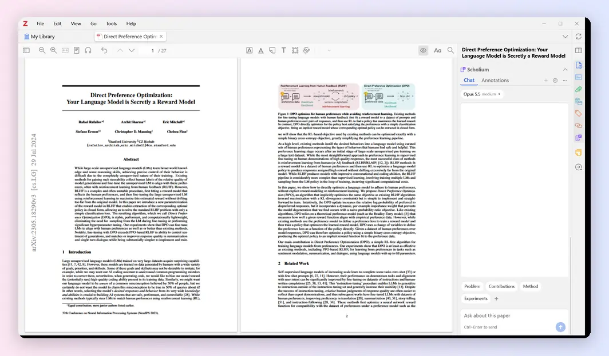
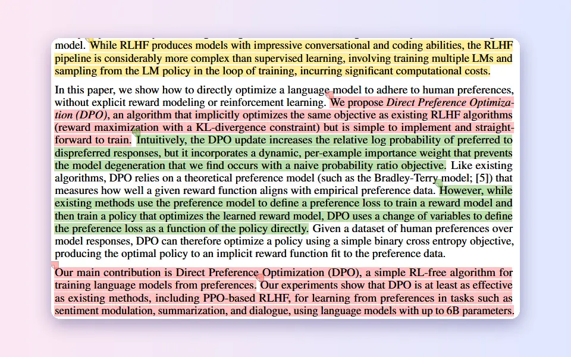
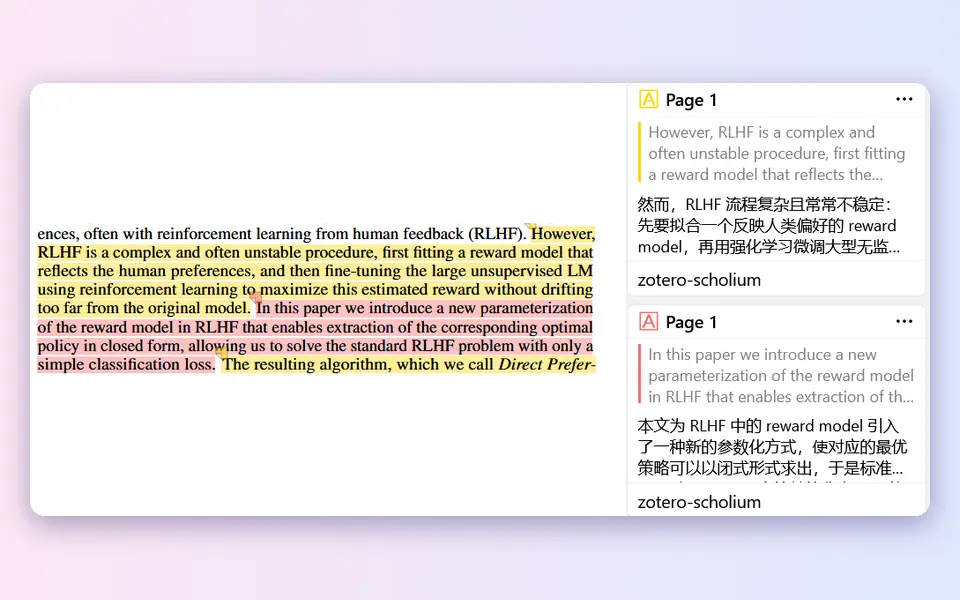
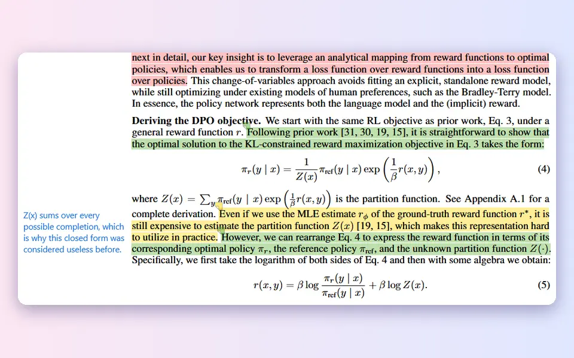
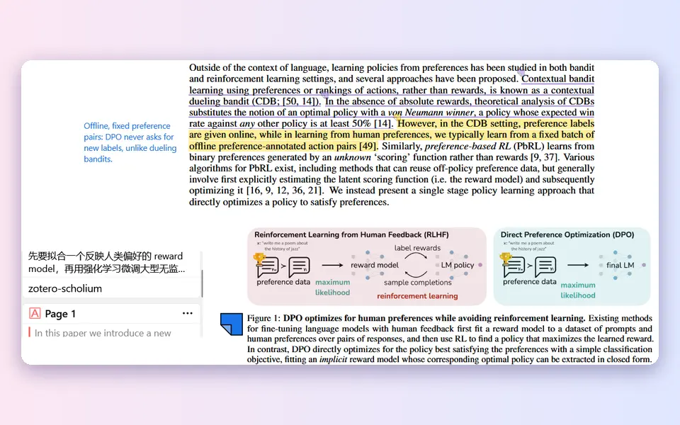
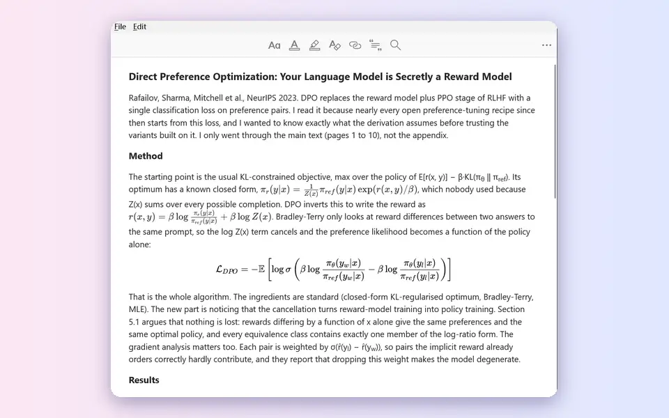
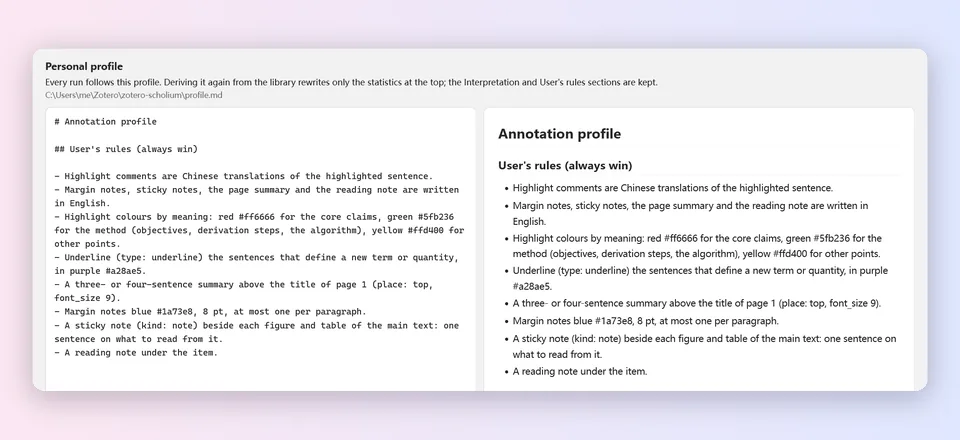
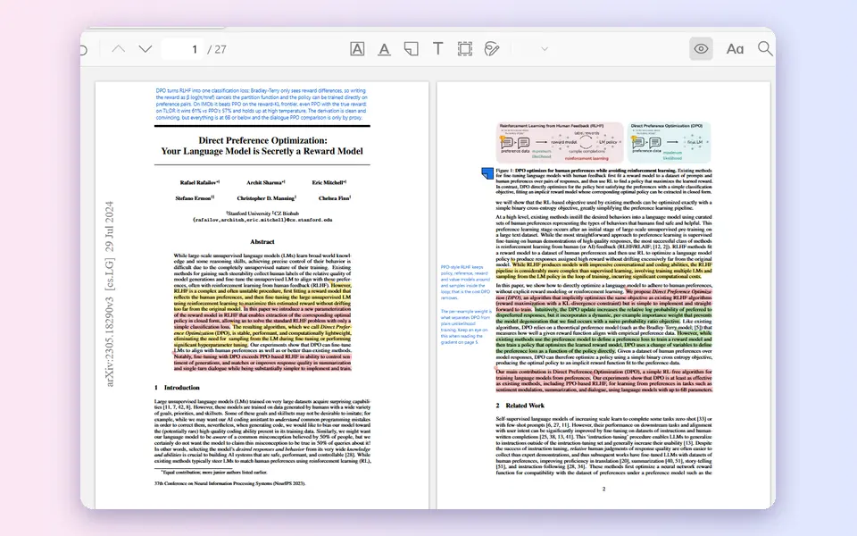
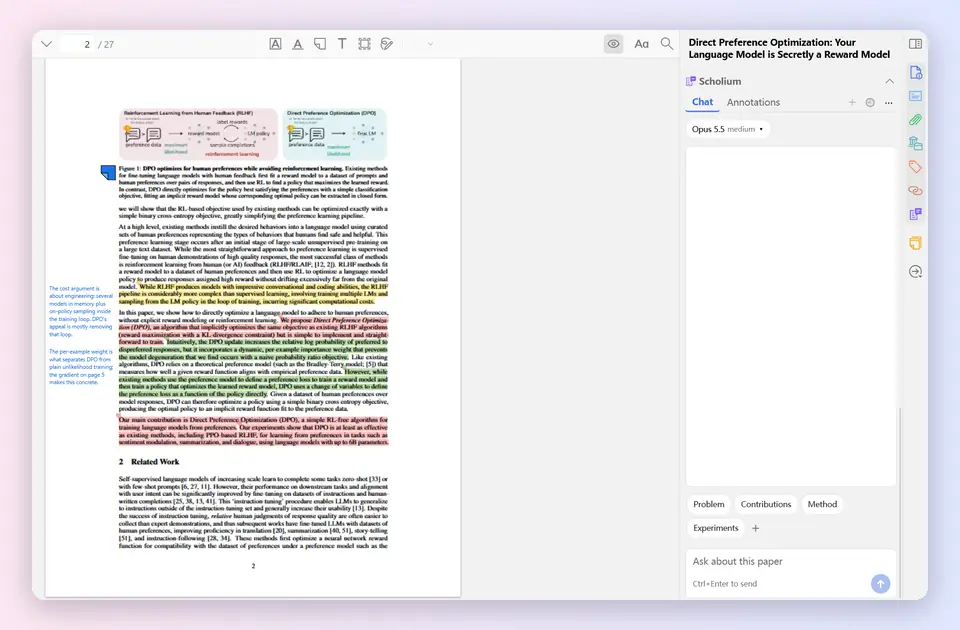
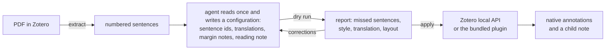

<div align="center">


# zotero-scholium

**Let Claude Code or Codex read a paper in Zotero, annotate it and answer your questions about it.**

Key sentences highlighted and translated, margin notes beside the paragraphs, a reading note under the item,<br>
all as native Zotero annotations you can edit, search and sync, and a chat about the paper beside it.

[](https://github.com/weilr/zotero-scholium/actions/workflows/ci.yml)
[](https://github.com/weilr/zotero-scholium/releases/latest)
[](https://www.zotero.org/)

English | [中文](README.zh-CN.md)

[Annotations](#annotations) · [The Scholium section](#the-scholium-section) · [Quick start](#quick-start) · [How it works](#how-it-works) · [Command line](docs/cli.md) · [Plugin](plugin/README.md) · [Changelog](CHANGELOG.md)

</div>



<sub>One run of Claude Code (Opus 5.5) on <i>Direct Preference Optimization</i> (CC BY 4.0) with the profile shown below, sped up (it took three and a half minutes). The chat and the profile below come from the same run; the other examples, from an earlier run with that profile.</sub>

## Annotations

<table>
<tr>
<td width="32%"><b>Highlights by meaning</b><br>Red for the claims that carry the paper, green for the method, yellow for the rest. The colours and what they stand for come from your profile.</td>
<td></td>
</tr>
<tr>
<td><b>A translation for every highlight</b><br>Each highlight's comment translates its sentence, and the sidebar shows the two together.</td>
<td></td>
</tr>
<tr>
<td><b>Margin notes</b><br>One or two sentences beside the paragraph: a reaction, a question, a link to another section. They stay clear of the text, the figures and each other.</td>
<td></td>
</tr>
<tr>
<td><b>A summary above the title</b><br>Three or four sentences across the top of page 1.</td>
<td></td>
</tr>
<tr>
<td><b>Underlines and sticky notes</b><br>Definitions underlined, a sticky note at each figure saying what to read from it, when your profile asks for them.</td>
<td></td>
</tr>
<tr>
<td><b>A reading note</b><br>A child note under the item: what the paper does, the numbers that matter, what convinces and what does not, open questions. Equations are rendered.</td>
<td></td>
</tr>
<tr>
<td><b>Your profile</b><br>How you annotate, learned from the annotations already in your library, plus your own rules. Every run follows it; edit it inside Zotero.</td>
<td></td>
</tr>
<tr>
<td><b>Show or hide</b><br>The eye button in the reader toolbar hides the tool's annotations in every reader and brings them back.</td>
<td></td>
</tr>
</table>

The agent does a dry run before writing: unmatched sentences, translations that add terms or numbers, stock phrases and overlapping highlights are reported and fixed first; a margin note without room moves to the other margin or becomes a sticky note. The skill follows the [Agent Skills](https://agentskills.io/) format, so Claude Code, Codex, Cursor and other agents can use it.

## The Scholium section

The plugin adds a **Scholium** section to Zotero's item pane, in the library and beside the PDF in the reader. It runs
the Claude Code or Codex installed on your computer on the paper shown.



**Annotations tab**

- **Annotate** with extra instructions if you like, such as *pages 3–5 only*. A card at the end counts what is in
  Zotero: highlights (and the core ones), margin notes, sticky notes and reading notes, with the turns and tokens.
- Words typed afterwards change the annotations in the same session, such as *shorten the translation on page 5*.
- **Annotate again** deletes the paper's Scholium annotations and moves its Scholium reading notes to the trash, then
  annotates anew. **Delete annotations** in the ⋯ menu removes them without a new run. Your own annotations and notes
  stay either way.

**Chat tab**

- Ask about the paper, or right-click a passage selected in the reader and choose **Ask Scholium**.
- Answers cite the paper's sentences as page chips (`p.4`): hover shows the sentence, a click finds it in the PDF.
- Claude Code and Codex share the paper's conversations: switch the agent and the next message goes to it. **＋** starts
  a conversation, 🕘 lists the earlier ones.
- ✎ on an earlier question asks it again, edited; **Undo** brings back what it replaced.
- Saved prompts above the box send with a click.
- Messages sent while the agent answers wait in a queue you can reorder; with Codex they can steer the answer under
  way.

**Runs**

- The chip under the tabs picks the agent, the model and the effort.
- The ring beside the send button shows how much of the context window the conversation takes; `/compact` compacts it.
- When an agent reaches its usage limit, only its runs pause, and they go on by themselves after the reset.
- A Scholium page in Zotero's settings holds the send shortcut, the follow-up behavior, the context ring and the paths
  of Claude Code and Codex.

Every detail is in [plugin/README.md](plugin/README.md).

## Quick start

You need Zotero 7 or later with its local API turned on (Settings → Advanced → *Allow other applications on this computer to communicate with Zotero*), and Python 3.9+ with PyMuPDF (`pip install pymupdf`).

### One click in Zotero

1. Install [Claude Code](https://claude.com/claude-code) or [Codex](https://github.com/openai/codex) and sign in.
2. Install the skill for it:
   ```bash
   npx skills add weilr/zotero-scholium -g -y
   ```
   `npx` comes with Node.js. Without it, install the skill from inside Claude Code with `/plugin` (see *Other ways* below).
3. Download [`scholium.xpi`](https://github.com/weilr/zotero-scholium/releases/latest/download/scholium.xpi) and install it in Zotero: Tools → Plugins → ⚙ → Install Plugin From File.
4. Select a paper, open the **Scholium** section and press **Annotate** on its **Annotations** tab. To ask about the paper, type the question on its **Chat** tab and send it.

### From your agent

Install the skill as above and ask in the conversation:

```
Annotate "Direct Preference Optimization" in my Zotero library
Highlight the key claims of "Direct Preference Optimization" with translations and add margin notes
Write a reading note for "Direct Preference Optimization"
```

Close and reopen the PDF afterwards to see the result. Without the plugin, Zotero 10 asks once whether the tool may write: choose *Always Allow*.

<details>
<summary>Other ways to install the skill, updating, and coming from Scholium Bridge</summary>

**Claude Code plugin**, kept up to date by `/plugin`:

```
/plugin marketplace add weilr/zotero-scholium
/plugin install zotero-scholium@zotero-scholium
```

**Manual:** copy [`skills/zotero-scholium/`](skills/zotero-scholium/) into the agent's skills directory: `~/.claude/skills/` for Claude Code, `~/.codex/skills/` for Codex, `~/.agents/skills/` for other agents. The directory is self-contained.

**Updating:** `npx skills update zotero-scholium`, or `/plugin update zotero-scholium@zotero-scholium`. The plugin updates itself through Zotero's add-on updater.

**From Scholium Bridge (0.1.9 or earlier):** Scholium Bridge does not update to Scholium by itself. Install Scholium as in step 3: it removes Scholium Bridge and keeps its settings and conversations; a run under way in Scholium Bridge stops, and its queued messages are not kept.

</details>

## How it works



The agent only picks sentence numbers and writes the text. The tool finds the exact words and their position on the page, places each margin note beside its paragraph where there is room, and writes everything through the bundled plugin, or through Zotero 10's local API without it.

From the Scholium section, the plugin starts Claude Code (`claude -p`) or Codex (`codex app-server`) on your computer, with the sign-in you already use for them; it does not read or store their credentials. The agent then follows the same skill.

More in [docs/design.md](docs/design.md) (data model, write channels, repeated runs) and [references/configuration.md](skills/zotero-scholium/references/configuration.md) (every option and report field).

## Contributing

Bug reports and pull requests are welcome; see [CONTRIBUTING.md](CONTRIBUTING.md).

## License

[MIT](LICENSE)

## Acknowledgements

- [Zotero](https://www.zotero.org/), whose local API made a plugin-free write channel possible.
- [PyMuPDF](https://pymupdf.readthedocs.io/), used for text extraction and page geometry.
- The screenshots show *Direct Preference Optimization: Your Language Model is Secretly a Reward Model* by Rafailov et al. (NeurIPS 2023, [arXiv:2305.18290](https://arxiv.org/abs/2305.18290), [CC BY 4.0](https://creativecommons.org/licenses/by/4.0/)).
