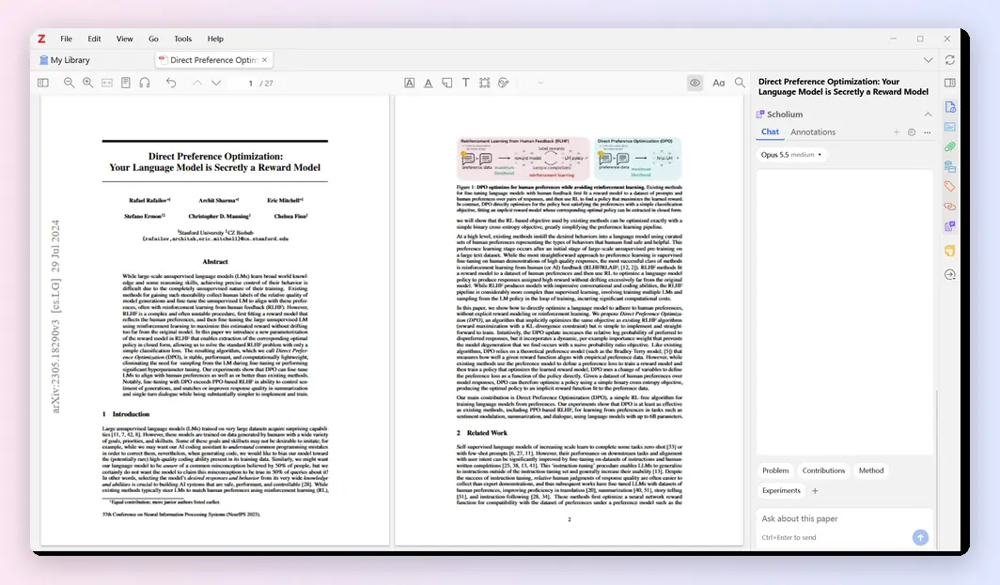
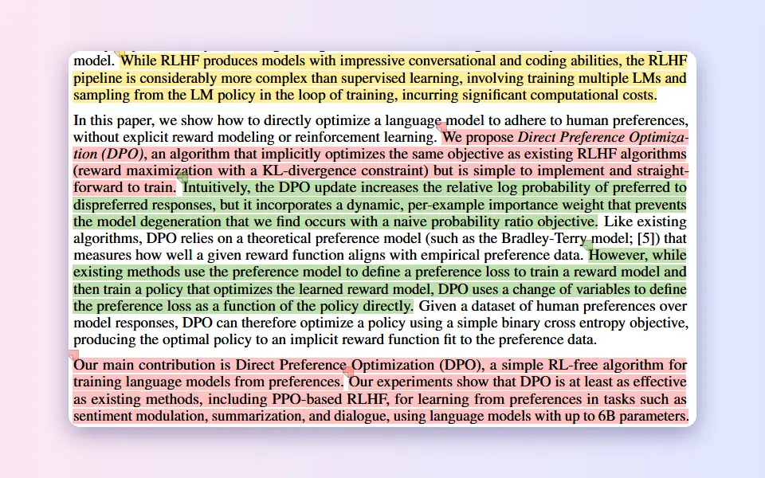
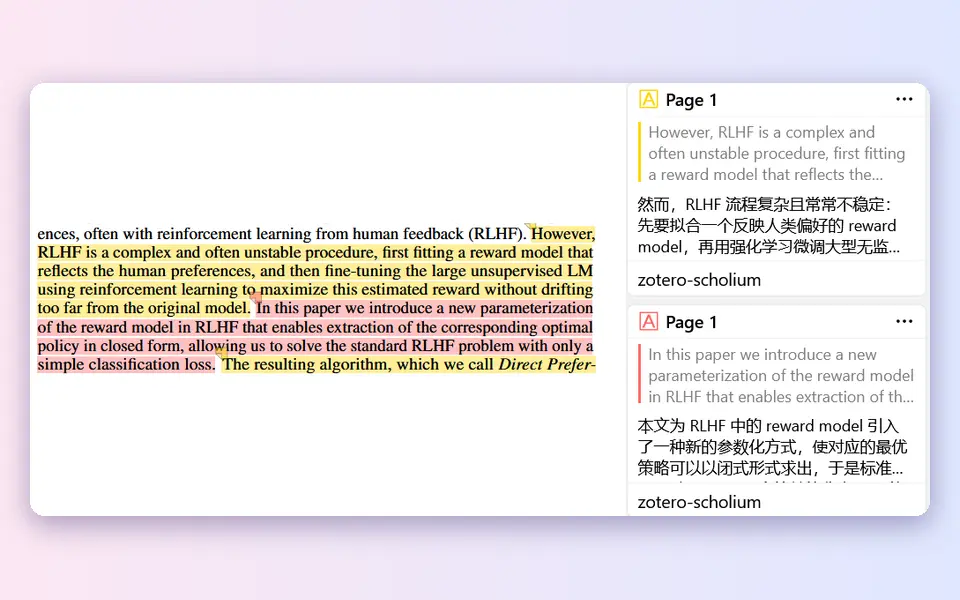
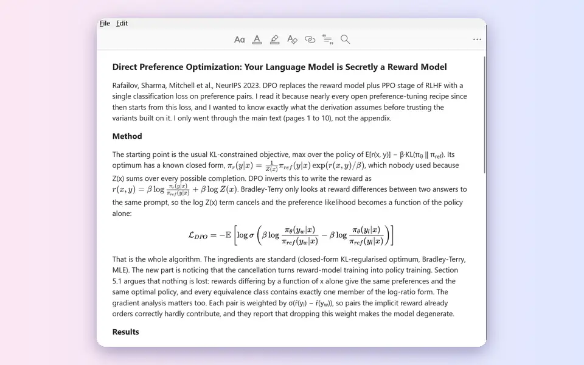
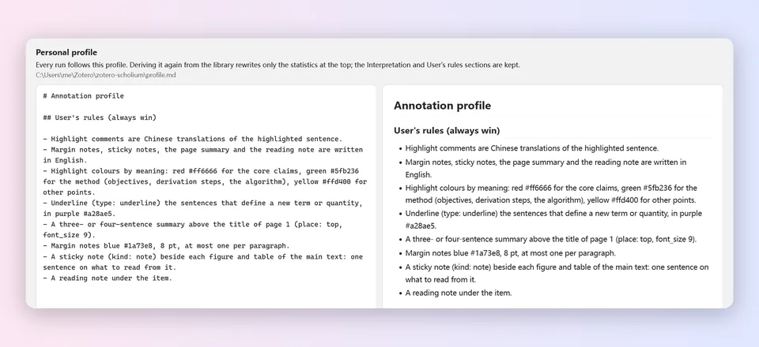
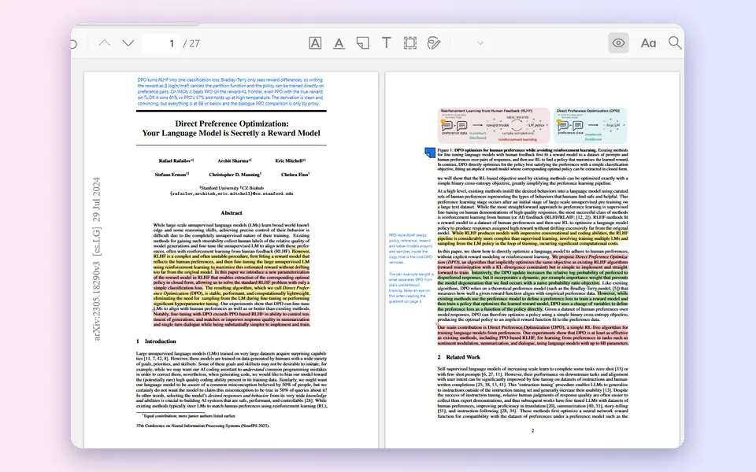
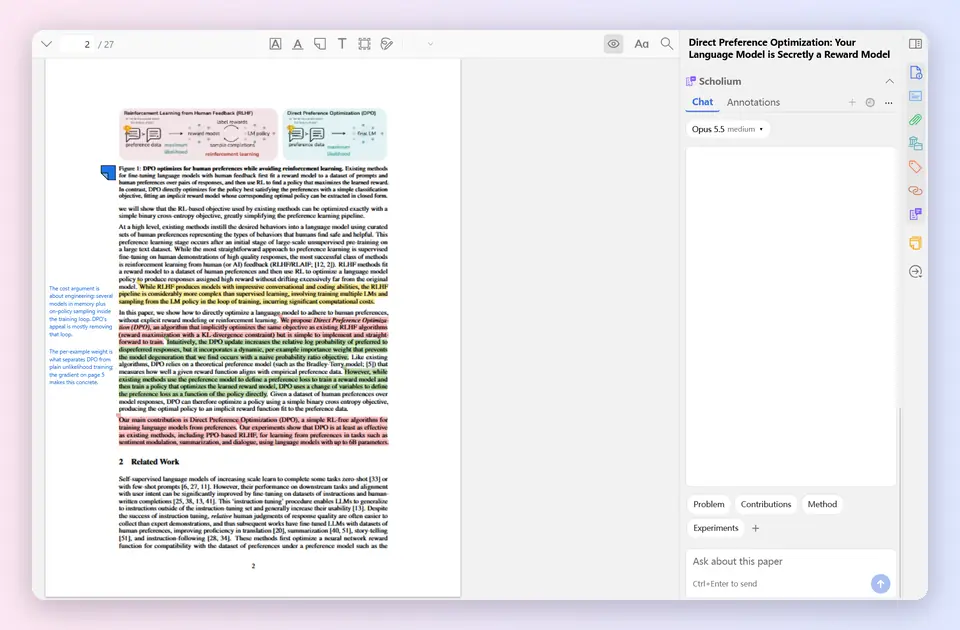

<div align="center">


# zotero-scholium（注疏）

**让 Claude Code 或 Codex 在 Zotero 里读论文：批注它，回答你关于它的问题。**

重点句高亮并附译文，段落旁写页边批注，条目下生成阅读笔记，全部是 Zotero 原生注释，可编辑、可检索、随文库同步；<br>
旁边还能就这篇论文对话。

[](https://github.com/weilr/zotero-scholium/actions/workflows/ci.yml)
[](https://github.com/weilr/zotero-scholium/releases/latest)
[](https://www.zotero.org/)

[English](README.md) | 中文

[批注](#批注) · [Scholium 区块](#scholium-区块) · [快速上手](#快速上手) · [工作原理](#工作原理) · [命令行](docs/cli.zh-CN.md) · [插件](plugin/README.md) · [更新日志](CHANGELOG.md)

</div>



<sub>用 Claude Code（Opus 5.5）对 <i>Direct Preference Optimization</i>（CC BY 4.0）运行一次，所用个人配置见下表；动图经过加速，实际用时三分半。下面的对话和个人配置来自同一次运行，其余示例来自之前用同一份配置的一次运行。</sub>

## 批注

<table>
<tr>
<td width="32%"><b>按含义分色高亮</b><br>红色是撑起全文的论点，绿色是方法，黄色是其余要点。用哪些颜色、各代表什么，由个人配置决定。</td>
<td></td>
</tr>
<tr>
<td><b>每条高亮附译文</b><br>高亮的评论就是这句话的译文，侧栏里原句和译文上下对照。论文本身是你的语言时，高亮不加评论。</td>
<td></td>
</tr>
<tr>
<td><b>页边批注</b><br>段落旁一两句话：读到这里的反应、疑问，或和其他章节的联系。不压正文、不压图表，彼此也不重叠。</td>
<td></td>
</tr>
<tr>
<td><b>标题上方的总结</b><br>首页顶部三四句话，概括全文。</td>
<td></td>
</tr>
<tr>
<td><b>下划线和便签</b><br>个人配置要求时，给定义加下划线，在每张图旁贴一张便签，说明该看什么。</td>
<td></td>
</tr>
<tr>
<td><b>阅读笔记</b><br>条目下的子笔记：论文做了什么、关键数字、哪些可信哪些存疑、悬而未决的问题。公式会渲染。</td>
<td></td>
</tr>
<tr>
<td><b>个人配置</b><br>从文库里已有的注释归纳你的标注习惯，再加上你自己的规则。每次运行都照它来，可以在 Zotero 里直接编辑。</td>
<td></td>
</tr>
<tr>
<td><b>显示或隐藏</b><br>阅读器工具栏里的眼睛按钮，在所有阅读器中隐藏或重新显示本工具的注释。</td>
<td></td>
</tr>
</table>

写入前代理会先预演：没对上的句子、多出术语或数字的译文、套话、重叠的高亮都会列出来，改好再写；放不下的页边批注会换到另一侧页边，或改成便签。技能遵循 [Agent Skills](https://agentskills.io/) 规范，Claude Code、Codex、Cursor 等代理都能用。

## Scholium 区块

插件在 Zotero 的条目窗格里加了一个 **Scholium** 区块，文库里和阅读器的 PDF 旁边都有。它在你的电脑上调用已安装的 Claude Code 或 Codex，处理当前显示的论文。



**批注页**

- 点 **批注这篇**，可以附加要求，比如「只批注第 3–5 页」。完成后的卡片给出 Zotero 里实际的数目：高亮（其中核心几条）、页边批注、便签、阅读笔记，以及轮数和 token 数。
- 之后在这里写的话，在同一个会话里接着修改批注，比如「把第 5 页的译文改短」。
- **重新批注** 会先删除这篇论文的 Scholium 批注，并把 Scholium 阅读笔记移到回收站，再重新批注；⋯ 菜单里的 **删除批注** 只删除、不重新批注。两种情况下你自己的批注和笔记都不动。
- 群组文库里的论文也能批注（需要你在群组里有编辑权限），群组的所有成员都能看到这些批注。

**对话页**

- 问关于这篇论文的问题；也可以在阅读器里选中一段，右键选 **问 Scholium**。在条目列表里选中 2–8 篇论文，右键菜单的 **问 Scholium（N 篇）** 会一起问它们。
- 回答以页码芯片（`p.4`）引用论文原句：悬停显示原句，点一下在 PDF 里找到它。
- Claude Code 和 Codex 共用这篇论文的对话：换了智能体，下一条消息就由它回答。**＋** 开新对话，时钟按钮列出之前的对话，⋯ 菜单里的 **存为笔记** 把当前对话存成论文的笔记。
- 之前的问题点 ✎ 可以改了再问；**撤销** 能找回被替换的内容。
- 输入框上方的常用问题，点一下就发送。
- 智能体回答时发的消息进入队列，可以拖动排序；用 Codex 时还能用它们引导正在进行的回答。

**运行**

- 标签页下方的芯片选择智能体、模型和推理强度。
- 发送按钮旁的圆环显示对话占了多少上下文窗口；`/compact` 压缩上下文。
- 某个智能体用量到达上限时，只暂停它的任务，到重置时间后自动继续。
- Zotero 设置里有一页 Scholium：发送快捷键、跟进处理方式、上下文圆环，以及 Claude Code 和 Codex 的路径。
- 插件跟随 Zotero 的界面语言：英文、简体中文、繁体中文、日文、韩文、德文、法文、西班牙文、俄文或葡萄牙文，智能体的译文、批注和回答也用这种语言。

全部细节见 [plugin/README.md](plugin/README.md)（英文）。

## 快速上手

需要 Zotero 7 及以上，以及 [uv](https://docs.astral.sh/uv/)（推荐：首次使用时自动准备 Python 和 PyMuPDF，一条命令即可安装），或 Python 3.9+ 和 PyMuPDF（`pip install pymupdf`）：

```bash
curl -LsSf https://astral.sh/uv/install.sh | sh                                     # macOS、Linux（或 brew install uv）
powershell -ExecutionPolicy ByPass -c "irm https://astral.sh/uv/install.ps1 | iex"   # Windows
```

国内下载慢时，可把环境变量 `UV_DEFAULT_INDEX` 设为镜像，例如 `https://pypi.tuna.tsinghua.edu.cn/simple`。

### 在 Zotero 里一键批注

1. 安装 [Claude Code](https://claude.com/claude-code) 或 [Codex](https://github.com/openai/codex) 并登录。
2. 下载 [`scholium.xpi`](https://github.com/weilr/zotero-scholium/releases/latest/download/scholium.xpi)，在 Zotero 中安装：工具 → 插件 → ⚙ → 从文件安装插件。
3. 选中一篇论文，打开 **Scholium** 区块，在 **批注** 页点 **批注这篇**。想提问时，在 **对话** 页写问题发送。

第一次运行时，插件会询问是否打开 Zotero 的本地 API；代理没有技能时，会给出 **安装技能并重试**。缺了什么，Zotero 设置 → Scholium → **环境检查** 会列出来，并给出解决办法。

### 在代理对话里使用

先安装技能：

```bash
npx skills add weilr/zotero-scholium -g -y
```

`npx` 随 Node.js 安装；Claude Code 也可以用 `/plugin` 安装（见下方）。再打开 Zotero 的本地 API（设置 → 高级 →「允许此计算机上的其他应用程序与 Zotero 通讯」），然后直接说：

```
给我 Zotero 里的《Direct Preference Optimization》做标注
把《Direct Preference Optimization》的核心论点高亮并翻译，加上页边批注
为《Direct Preference Optimization》写一篇阅读笔记
```

批注写入后会自己出现在打开的 PDF 里；装了插件时，阅读器工具栏的眼睛按钮显示或隐藏它们。没装插件时，Zotero 10 首次写入会询问是否允许，选「始终允许」。

<details>
<summary>其他安装方式、更新，以及从 Scholium Bridge 升级</summary>

**Claude Code 插件**，由 `/plugin` 负责更新：

```
/plugin marketplace add weilr/zotero-scholium
/plugin install zotero-scholium@zotero-scholium
```

**手动安装：** 将 [`skills/zotero-scholium/`](skills/zotero-scholium/) 复制到代理的技能目录：Claude Code 为 `~/.claude/skills/`，Codex 为 `~/.codex/skills/`，其他代理为 `~/.agents/skills/`。该目录自成一体。

**更新：** `npx skills update zotero-scholium`，或 `/plugin update zotero-scholium@zotero-scholium`。插件通过 Zotero 的插件更新机制自动更新。

**从 Scholium Bridge（0.1.9 及更早）升级：** Scholium Bridge 不会自行更新到 Scholium。按第 2 步安装 Scholium：它会移除 Scholium Bridge，并保留原有的设置和对话；Scholium Bridge 里正在进行的任务会停下，排队的消息不保留。

</details>

## 工作原理


代理只需挑句子编号、写内容。原文在页面上的准确位置、页边批注放在段落旁哪块空白，都由工具算出；最后通过随附插件写入，没装插件时用 Zotero 10 的本地 API。

在 Scholium 区块里，插件在你的电脑上启动 Claude Code（`claude -p`）或 Codex（`codex app-server`），用的是你平时登录它们的账号；插件不读取、也不保存它们的凭据。之后代理照同一个技能工作。

详见 [docs/design.md](docs/design.md)（数据模型、写入通道、重复运行）和 [references/configuration.md](skills/zotero-scholium/references/configuration.md)（全部选项与报告字段），两者均为英文。

## 参与贡献

欢迎提交问题报告和合并请求，开发说明见 [CONTRIBUTING.md](CONTRIBUTING.md)。

## 许可证

[MIT](LICENSE)

## 致谢

- [Zotero](https://www.zotero.org/)：其本地 API 使无插件写入成为可能。
- [PyMuPDF](https://pymupdf.readthedocs.io/)：用于文本提取与页面几何分析。
- 截图中的论文是 Rafailov 等人的 *Direct Preference Optimization: Your Language Model is Secretly a Reward Model*（NeurIPS 2023，[arXiv:2305.18290](https://arxiv.org/abs/2305.18290)，[CC BY 4.0](https://creativecommons.org/licenses/by/4.0/)）。
